# Architecture

The repository keeps modeling, product rules, and presentation separate so that campaign preferences cannot silently change the traffic estimate.

```mermaid
flowchart LR
    sources["Amsterdam Open Data and OpenStreetMap"] --> fetch["Fetch and cache"]
    fetch --> features["Location feature pipeline"]
    features --> experiments["Target and feature experiments"]
    experiments --> model["Huber-Ridge model artifact"]
    model --> bundle["Versioned runtime bundle"]
    bundle --> evaluator["Deterministic candidate evaluator"]
    evaluator --> evidence["Prediction and reliability evidence"]
    evidence --> rules["Campaign eligibility rules"]
    rules --> dashboard["Static shortlist dashboard"]
    rules --> cli["JSON CLI"]
    cli --> skill["ZAP location-intelligence skill"]
```

## Runtime boundary

The published dashboard remains a static application. Model coefficients, compact location features, validation evidence, and shortlist rules are bundled into the generated HTML. The same generated context is also written to `outputs/runtime/runtime_bundle.json`, allowing the Python runtime, CLI, and skill to evaluate locations without the excluded 198 MB raw-data cache. A live model server is not required. Internet access is used only for map libraries and basemap tiles.

The browser and Python implementations are checked against golden coordinates and shortlist fixtures in CI. This cross-runtime contract prevents the static dashboard and agent-facing tools from silently diverging.

## Main components

| Component | Responsibility |
| --- | --- |
| `src/fetch_data.py` | Download and cache public source data |
| `src/build_features.py` | Build reproducible location features |
| `src/target_model_experiments.py` | Audit targets and robust-model variants |
| `src/feature_experiments.py` | Compare candidate feature sets |
| `src/model_weekly_passers.py` | Train, validate, and serialize the selected model |
| `src/evaluate_location.py` | Apply the same feature and model logic to a new coordinate |
| `src/runtime_engine.py` | Evaluate a coordinate from the compact versioned runtime bundle |
| `src/shortlist.py` | Apply shared campaign eligibility and exposure-ranking rules |
| `src/agent_cli.py` | Expose deterministic evaluation and shortlisting as structured JSON |
| `src/generate_dashboard.py` | Generate the self-contained product dashboard |
| `.agents/skills/zap-location-intelligence/` | Teach an agent when and how to invoke the deterministic tools |

## Decision boundary

The model estimates typical weekly pedestrian exposure. Campaign objectives are applied afterward as transparent eligibility filters. Screen visibility, price, availability, audience demographics, and ROI remain external inputs that require operational data or field validation.
